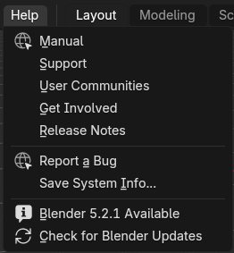
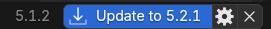
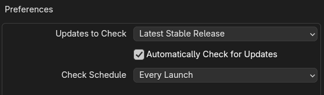

# Release Watcher

[](https://github.com/Osmosae/blender-check-for-updates/actions/workflows/ci.yml)

A lightweight Blender extension that checks Blender's official build service and
lets you know when a newer release is available.

It supports Blender 4.2.1 and newer on Windows, macOS, and Linux. The extension
only reports updates—it never downloads, installs, or replaces Blender.

Release Watcher is an independent community extension and is not affiliated
with or endorsed by the Blender Foundation.

## At a glance

Available releases appear alongside the manual update command in Blender's Help
menu:



The same update can be opened, configured, or dismissed from the status bar:



Automatic checks are opt-in and can be configured from the extension
preferences:



## Why Release Watcher?

Blender's open [Update Notifier design task](https://projects.blender.org/blender/blender/issues/149136)
proposes built-in release notifications, with optional self-updates as a
longer-term goal. The proposal is currently marked **Design in-progress** and
does not have a target release. Until that work ships, Release Watcher provides
an independent implementation of the notification part. It only reports that a
release is available and opens the official download page; it does not download
or install Blender updates.

## Features

- Check manually from **Help → Check for Blender Updates**.
- Optionally check automatically on launch, daily, weekly, or every 30 days.
- Follow the latest stable release, the current major/minor release series, or
  daily development builds.
- Open the appropriate official Blender download page when an update is found.
- Dismiss a status-bar notification for the reported version and restore it
  later from the extension preferences.
- Run network checks in a separate process so Blender's interface remains
  responsive.
- Retry temporary automatic-check failures without displaying disruptive error
  notifications.
- Respect Blender's **Allow Online Access** setting.

Automatic checks are disabled by default.

## Installation

1. Download `release_watcher-x.y.z.zip` from the
   [latest release](https://github.com/Osmosae/blender-check-for-updates/releases/latest).
2. Do not extract the ZIP.
3. Drag the ZIP into Blender and confirm the installation, or select
   **Edit → Preferences → Extensions → Install from Disk**.
4. To configure the extension, open Blender's add-on preferences and search for
   **Release Watcher**.

## Update channels

| Channel | Checks for |
| --- | --- |
| Latest Stable Release | The newest public Blender release available for your platform and architecture |
| Current Release Series | Updates within the installed major/minor series; includes newer alpha, beta, and RC builds while running a prerelease |
| Daily Builds | The newest development series, including alpha builds of the next Blender version |

For example, on **5.3.0 beta**, Current Release Series follows newer 5.3 beta/RC
builds and the final 5.3 release. After installing a stable release it follows
stable corrective releases in that series. Daily Builds can instead offer
**5.4.0 alpha**.

Development builds are compared by commit hash and, when the version and release
stage are unchanged, commit time. An unchanged hash or an older commit is not an
update, even if an archive was uploaded more recently. If commit information
cannot be verified, the check reports an error instead of claiming a build is
newer or up to date.

If the selected channel changes while a check is running, the old result is
discarded and the newly selected channel is checked instead.

## Automatic schedules

- **Every Launch:** checks once, 45–90 seconds after Blender starts.
- **Daily:** checks after 24 hours have elapsed since the last successful check.
- **Weekly:** checks after seven days.
- **Monthly:** checks after 30 days.

Failed automatic checks retry after 15 minutes, then 30 minutes, and then at
most once per hour. Errors and the last-check time remain available in the
extension preferences.

## Platform support

The release is a single platform-independent ZIP containing the extension's
Python modules, manifest, README, changelog, and license; it does not require
bundled Python wheels. Repository-only material, including `tests/`, `.github/`,
and the screenshot files under `docs/images/`, is excluded from the ZIP. CI
builds the package once on Linux and installs that exact artifact on each tested
platform.

| Platform | Blender coverage |
| --- | --- |
| Linux x64 | Declared minimum version and current release |
| macOS ARM64 | Current release |
| Windows x64 | Current release |

## Network and privacy

The extension makes bounded HTTPS requests to Blender's official build listing,
using its download table if the JSON service fails. Same-version development
checks also read the listed commit's time from Blender's public source service.
It validates returned download hosts, does not collect telemetry, and does not
send project files or personal data anywhere.

## Development

Run the regular Python tests without Blender:

```console
python -m unittest discover -s tests -p "test_*.py" -v
```

With `blender` available on your path, validate and build the extension:

```console
blender --command extension validate
blender --command extension build
```

The [CI workflow](.github/workflows/ci.yml) also verifies package contents and
runs registration and installed-extension smoke tests in isolated Blender
profiles.

## License

Release Watcher is available under the
[GNU General Public License v3.0 or later](LICENSE).
